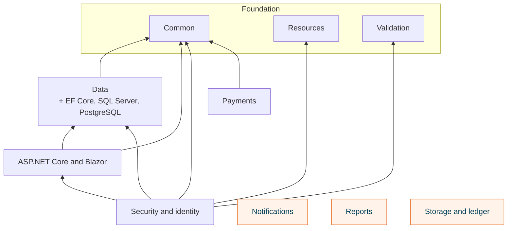
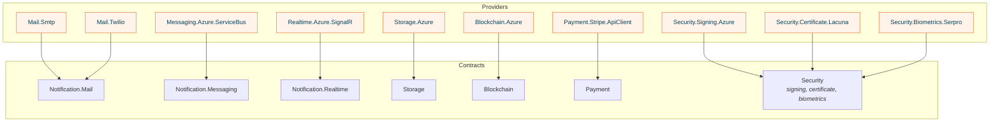
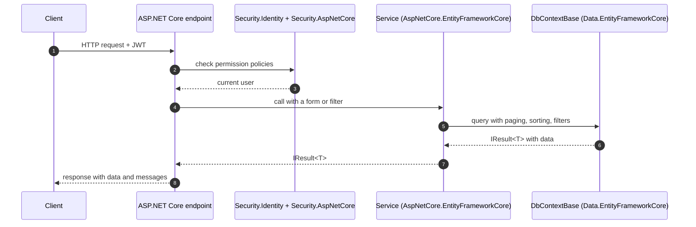

# Architecture

The framework is organized in eight areas. Packages in one area may build on the foundation and on other areas, never the other way round, so referencing a package never drags in an unrelated stack.

## Areas and how they depend on each other

Notifications, reports and storage (in orange) depend on no other Nuv Tools package: they can be used in any .NET application on their own.

## Contracts and providers

Every area that talks to an outside service splits in two kinds of package:

- **The contract** — interfaces and models, no vendor SDK. Application code references only this.
- **One package per provider** — the implementation and its `Add…` registration. Only the host project references it.

The vendor SDK (MailKit, Azure SDKs, Stripe.net, Lacuna REST PKI) is referenced only by its provider package, so a contract never pulls a vendor into your domain or application layer.

## Inside a request

A typical ASP.NET Core API built on the framework, from the request to the database and back:

## Where each package lives

Each area is a separate repository under [github.com/nuvtools](https://github.com/nuvtools), released with its own pipeline. The [guides](../guides/foundation/index.md) link to each repository, and the API reference is generated from the same sources.
