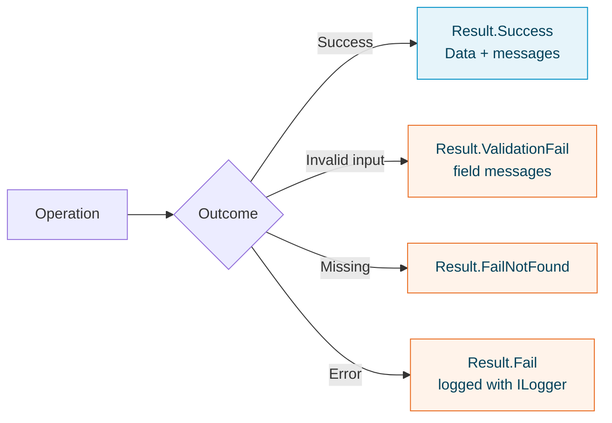

# Getting started

The framework is a set of independent NuGet packages. Reference only the ones you need; each brings the Nuv Tools packages it builds on.

## Requirements

- .NET 8, 9 or 10. Every package targets all three.
- Packages that talk to a cloud service (Azure, Twilio, Stripe, Lacuna, SERPRO) need that service's account and credentials; the rest have no external requirement.

## Install

```bash
dotnet add package NuvTools.Common
```

Add the contract your application code uses, and the provider package only where you compose the application:

```bash
# Application layer: the contract
dotnet add package NuvTools.Notification.Mail

# Host project: the provider
dotnet add package NuvTools.Notification.Mail.Smtp
```

## Register and use

Providers register themselves on `IServiceCollection` and bind their settings from configuration.

```json
{
  "MailSmtp": {
    "Host": "smtp.example.com",
    "Port": 587,
    "UserName": "app@example.com"
  }
}
```

Keep `MailSmtp:Password` out of the file: set it with user secrets locally and a key vault or an environment variable when deployed.

```csharp
// Program.cs — the only place that knows the provider
builder.Services.AddSmtpMail(builder.Configuration);
```

```csharp
// Anywhere else — only the contract
public class WelcomeMail(IMailService mail)
{
    public Task SendAsync(string to, CancellationToken cancellationToken) =>
        mail.SendAsync(new MailMessage
        {
            From = new MailAddress { Address = "no-reply@example.com", DisplayName = "Example" },
            To = [new MailAddress { Address = to }],
            Subject = "Welcome",
            Body = "<p>Your account is ready.</p>"
        }, cancellationToken);
}
```

Each provider's guide lists its settings section and options; for e-mail, see [Mail](../guides/notification/notification/docs/Mail.md).

## Report outcomes with results

Services across the framework answer with `IResult` / `IResult<T>` from `NuvTools.Common`, so success, validation failures and errors travel the same way from the data layer to the API.

```csharp
using NuvTools.Common.ResultWrapper;

public IResult<User> GetUser(int id)
{
    if (id <= 0)
        return Result<User>.ValidationFail("Invalid user ID");

    var user = repository.FindById(id);
    if (user is null)
        return Result<User>.FailNotFound("User not found");

    return Result<User>.Success(user);
}
```



The [NuvTools.Common guide](../guides/foundation/common/README.md) covers the full result API, including HTTP conversion with `ToResultAsync()`.

## Versions

The major version follows .NET: 10.x packages are built for the .NET 10 generation (and still target 8 and 9). A minor version marks a breaking change; everything else is a patch.

## Next steps

- Browse the [guides by area](../guides/foundation/index.md).
- Look up any type in the [API reference](../api/index.md).
- See how the areas relate in [Architecture](architecture.md).
