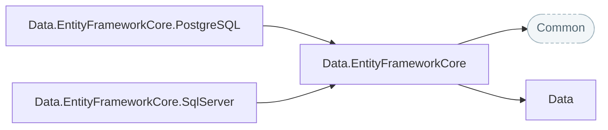

# Data

Paging, sorting and filtering that work on any IQueryable, and an Entity Framework Core base with CRUD, transactions and bulk operations, ready for SQL Server and PostgreSQL.

## How the packages fit

Each arrow points at the package it builds on. Rounded, dashed boxes are Nuv Tools packages from another area.

## Packages

| Package | What it does | Builds on |
| --- | --- | --- |
| [Data](https://www.nuget.org/packages/NuvTools.Data) | ORM-agnostic .NET library for data manipulation with paging, sorting, and filtering utilities for IQueryable and IEnumerable collections. | — |
| [Data.EntityFrameworkCore](https://www.nuget.org/packages/NuvTools.Data.EntityFrameworkCore) | Entity Framework Core extensions providing DbContextBase with CRUD operations, Result pattern error handling, transaction management, bulk operations, and async paging. | `Common`, `Data` |
| [Data.EntityFrameworkCore.PostgreSQL](https://www.nuget.org/packages/NuvTools.Data.EntityFrameworkCore.PostgreSQL) | PostgreSQL integration for NuvTools.Data.EntityFrameworkCore with simplified DbContext registration, configuration from appsettings.json, and snake_case naming convention support. | `Data.EntityFrameworkCore` |
| [Data.EntityFrameworkCore.SqlServer](https://www.nuget.org/packages/NuvTools.Data.EntityFrameworkCore.SqlServer) | SQL Server integration for NuvTools.Data.EntityFrameworkCore with simplified DbContext registration and configuration from appsettings.json. | `Data.EntityFrameworkCore` |

## Guides

- [NuvTools.Data](data/README.md) — installation, configuration and examples; source on [GitHub](https://github.com/nuvtools/nuvtools-data).

Every type and member is in the [API reference](xref:NuvTools.Data.Paging).
