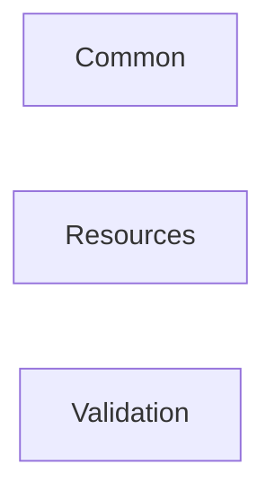

# Foundation

The building blocks every other package leans on: a standard result type, common helpers, bilingual resources and validation of Brazilian documents.

## How the packages fit

Each arrow points at the package it builds on. Rounded, dashed boxes are Nuv Tools packages from another area.

## Packages

| Package | What it does | Builds on |
| --- | --- | --- |
| [Common](https://www.nuget.org/packages/NuvTools.Common) | Common library for Web, Desktop and Mobile (MAUI) applications. | — |
| [Resources](https://www.nuget.org/packages/NuvTools.Resources) | Bilingual localization library (English/Portuguese) with 470+ resources: actions, fields, and parameterized message templates for .NET applications. | — |
| [Validation](https://www.nuget.org/packages/NuvTools.Validation) | Validation helpers including email, numeric, Brazilian documents (CPF, CNPJ, phone, CEP), password complexity attributes, and data annotations. | — |

## Guides

- [NuvTools.Common](common/README.md) — installation, configuration and examples; source on [GitHub](https://github.com/nuvtools/nuvtools-common).
- [NuvTools.Resources](resources/README.md) — installation, configuration and examples; source on [GitHub](https://github.com/nuvtools/nuvtools-resources).
- [NuvTools.Validation](validation/README.md) — installation, configuration and examples; source on [GitHub](https://github.com/nuvtools/nuvtools-validation).

Every type and member is in the [API reference](../../api/index.md#area-foundation).
