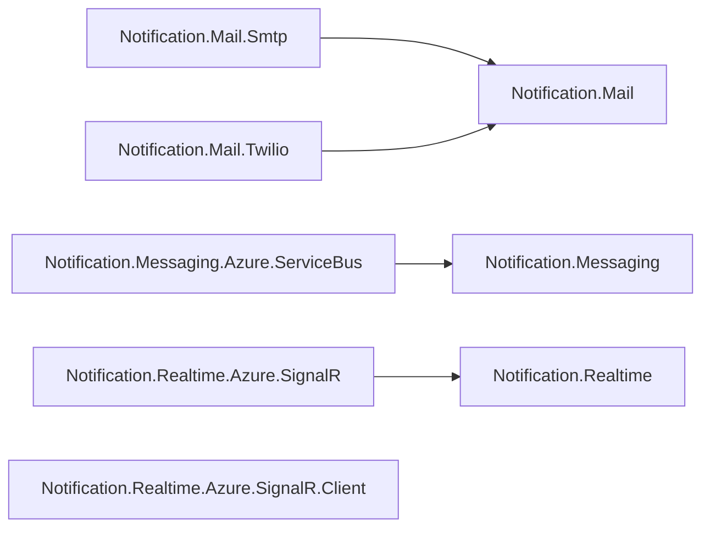

# Notifications

Three transport-neutral contracts, e-mail, messaging and real time, each with its providers: SMTP and Twilio, Azure Service Bus, and Azure SignalR.

## How the packages fit

Each arrow points at the package it builds on. Rounded, dashed boxes are Nuv Tools packages from another area.

## Packages

| Package | What it does | Builds on |
| --- | --- | --- |
| [Notification.Mail](https://www.nuget.org/packages/NuvTools.Notification.Mail) | Abstraction library for email notifications in .NET applications. | — |
| [Notification.Mail.Smtp](https://www.nuget.org/packages/NuvTools.Notification.Mail.Smtp) | SMTP implementation for NuvTools.Notification.Mail using MailKit and MimeKit. | `Notification.Mail` |
| [Notification.Mail.Twilio](https://www.nuget.org/packages/NuvTools.Notification.Mail.Twilio) | Twilio Email API implementation for NuvTools.Notification.Mail. | `Notification.Mail` |
| [Notification.Messaging](https://www.nuget.org/packages/NuvTools.Notification.Messaging) | Abstraction library for building messaging solutions in .NET applications. | — |
| [Notification.Messaging.Azure.ServiceBus](https://www.nuget.org/packages/NuvTools.Notification.Messaging.Azure.ServiceBus) | Azure Service Bus implementation for NuvTools.Notification.Messaging. | `Notification.Messaging` |
| [Notification.Realtime](https://www.nuget.org/packages/NuvTools.Notification.Realtime) | Abstraction library for real-time notifications in .NET applications. | — |
| [Notification.Realtime.Azure.SignalR](https://www.nuget.org/packages/NuvTools.Notification.Realtime.Azure.SignalR) | Azure SignalR server-side implementation for NuvTools.Notification.Realtime. | `Notification.Realtime` |
| [Notification.Realtime.Azure.SignalR.Client](https://www.nuget.org/packages/NuvTools.Notification.Realtime.Azure.SignalR.Client) | Azure SignalR client-side implementation for receiving real-time notifications. | — |

## Guides

- [NuvTools.Notification](notification/README.md) — installation, configuration and examples; source on [GitHub](https://github.com/nuvtools/nuvtools-notification).

Every type and member is in the [API reference](xref:NuvTools.Notification.Mail).
