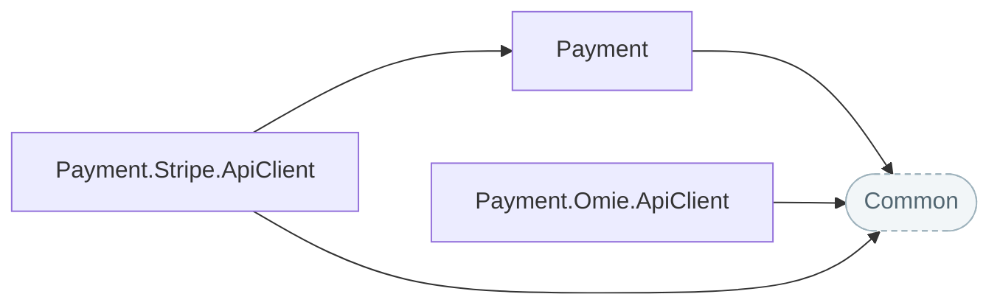

# Payments

Provider-neutral contracts for customers, payment methods, charges, payouts and webhooks, with typed clients for Stripe and the Omie ERP.

## How the packages fit

Each arrow points at the package it builds on. Rounded, dashed boxes are Nuv Tools packages from another area.

## Packages

| Package | What it does | Builds on |
| --- | --- | --- |
| [Payment](https://www.nuget.org/packages/NuvTools.Payment) | Provider-neutral payment abstractions: contracts for customers and saved payment methods, payee accounts and their onboarding, charges and transfers, and webhook verification, with minor-unit arithmetic and the shared resilient HttpClient registration the NuvTools.Payment provider clients build on. | `Common` |
| [Payment.Omie.ApiClient](https://www.nuget.org/packages/NuvTools.Payment.Omie.ApiClient) | Typed HTTP client for the Omie ERP API. | `Common` |
| [Payment.Stripe.ApiClient](https://www.nuget.org/packages/NuvTools.Payment.Stripe.ApiClient) | Typed client for Stripe, covering customers and saved payment methods, Connect Express onboarding, separate charges and transfers, and webhook signature verification. | `Common`, `Payment` |

## Guides

- [NuvTools.Payment](payment/README.md) — installation, configuration and examples; source on [GitHub](https://github.com/nuvtools/nuvtools-payment).

Every type and member is in the [API reference](../../api/index.md#area-payment).
