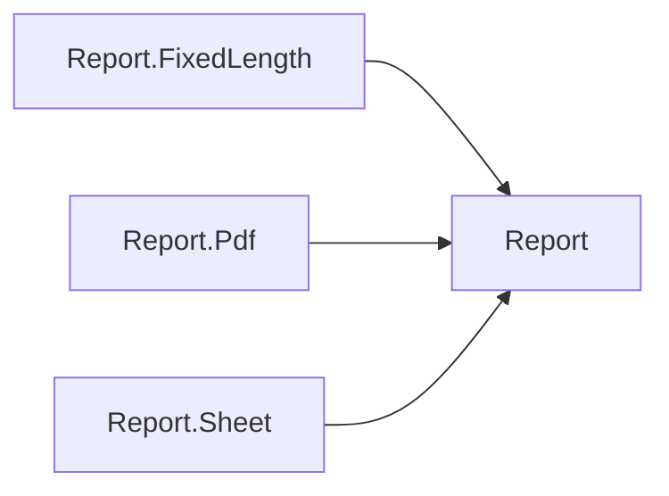

# Reports

One report model, bound from your own classes, exported to PDF, Excel and CSV, plus readers for CSV and fixed-length files.

## How the packages fit

Each arrow points at the package it builds on. Rounded, dashed boxes are Nuv Tools packages from another area.

## Packages

| Package | What it does | Builds on |
| --- | --- | --- |
| [Report](https://www.nuget.org/packages/NuvTools.Report) | Core report model infrastructure with document-table hierarchy, reflection-based data binding, PDF abstractions (IPdfExporter, IPdfMerger), and Sheet abstractions for CSV/Excel/fixed-length file reading and exporting (ICsvReader, ICsvExporter, IExcelExporter, IFixedLengthReader) with attribute-based field mapping and custom converters. | — |
| [Report.FixedLength](https://www.nuget.org/packages/NuvTools.Report.FixedLength) | Implementation of NuvTools.Report.FixedLength abstractions: reflection-based reader for fixed-length (positional) text files with attribute-based field mapping, custom converters, and trim/optional-field support. | `Report` |
| [Report.Pdf](https://www.nuget.org/packages/NuvTools.Report.Pdf) | PDF report generation with table rendering, company branding, and document merging using QuestPDF and PDFsharp. | `Report` |
| [Report.Sheet](https://www.nuget.org/packages/NuvTools.Report.Sheet) | Implementation of NuvTools.Report.Sheet abstractions: Excel export with multi-sheet workbooks and styled formatting using ClosedXML, and CSV export and reading with RFC 4180 support. | `Report` |

## Guides

- [NuvTools.Report](report/README.md) — installation, configuration and examples; source on [GitHub](https://github.com/nuvtools/nuvtools-report).

Every type and member is in the [API reference](../../api/index.md#area-report).
