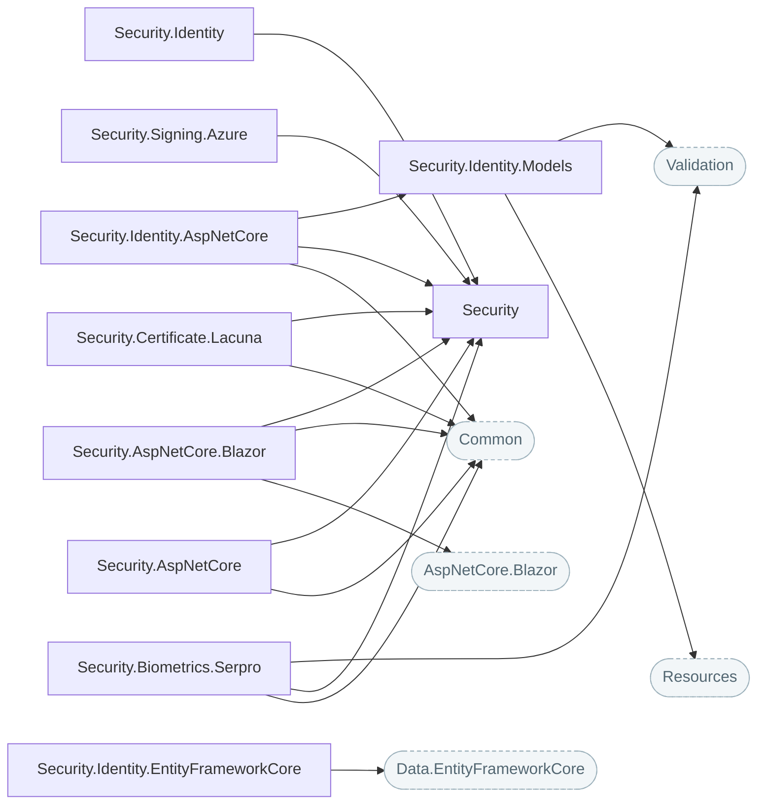

# Security and identity

Tokens, cryptography, SSRF protection and CAPTCHA, permission-based authorization on ASP.NET Identity, and contracts for signing keys, certificates and facial verification with their providers.

## How the packages fit

Each arrow points at the package it builds on. Rounded, dashed boxes are Nuv Tools packages from another area.

## Packages

| Package | What it does | Builds on |
| --- | --- | --- |
| [Security](https://www.nuget.org/packages/NuvTools.Security) | Core security library providing JWT token handling, cryptography utilities, ClaimsPrincipal extensions, the shared CAPTCHA contract, the certificate authentication and facial verification contracts, and SSRF protection for outbound HTTP. | — |
| [Security.AspNetCore](https://www.nuget.org/packages/NuvTools.Security.AspNetCore) | Security configuration, authenticated user services and adaptive CAPTCHA verification for ASP.NET Core applications. | `Common`, `Security` |
| [Security.AspNetCore.Blazor](https://www.nuget.org/packages/NuvTools.Security.AspNetCore.Blazor) | Authentication state providers for Blazor applications with JWT and OIDC support, plus an adaptive CAPTCHA component. | `AspNetCore.Blazor`, `Common`, `Security` |
| [Security.Biometrics.Serpro](https://www.nuget.org/packages/NuvTools.Security.Biometrics.Serpro) | SERPRO Datavalid implementation of the NuvTools.Security facial verification contract: a capture is matched against the face on government record for a CPF. | `Common`, `Security`, `Validation` |
| [Security.Certificate.Lacuna](https://www.nuget.org/packages/NuvTools.Security.Certificate.Lacuna) | Lacuna REST PKI implementation of the NuvTools.Security certificate authentication contract: possession of the private key and the ICP-Brasil chain are validated on the service. | `Common`, `Security` |
| [Security.Signing.Azure](https://www.nuget.org/packages/NuvTools.Security.Signing.Azure) | Azure Key Vault implementation of the NuvTools.Security signing key contract: tokens are signed by a key that never leaves the vault, and a rotated key is picked up without a restart. | `Security` |
| [Security.Identity](https://www.nuget.org/packages/NuvTools.Security.Identity) | Permission-based authorization with dynamic policy provider and claim-based permission handler for ASP.NET Identity. | `Security` |
| [Security.Identity.AspNetCore](https://www.nuget.org/packages/NuvTools.Security.Identity.AspNetCore) | ASP.NET Core user management service with email confirmation, password management, and role administration for ASP.NET Identity. | `Common`, `Security`, `Security.Identity.Models` |
| [Security.Identity.EntityFrameworkCore](https://www.nuget.org/packages/NuvTools.Security.Identity.EntityFrameworkCore) | Entity Framework Core identity persistence with transaction management and batch operations for ASP.NET Identity. | `Data.EntityFrameworkCore` |
| [Security.Identity.Models](https://www.nuget.org/packages/NuvTools.Security.Identity.Models) | ASP.NET Identity base models, form DTOs, and API models with localized validation for user and role management. | `Resources`, `Validation` |

## Guides

- [NuvTools.Security](security/README.md) — installation, configuration and examples; source on [GitHub](https://github.com/nuvtools/nuvtools-security).
- [NuvTools.Security.Identity](security-identity/README.md) — installation, configuration and examples; source on [GitHub](https://github.com/nuvtools/nuvtools-security-identity).

Every type and member is in the [API reference](xref:NuvTools.Security.Biometrics).
