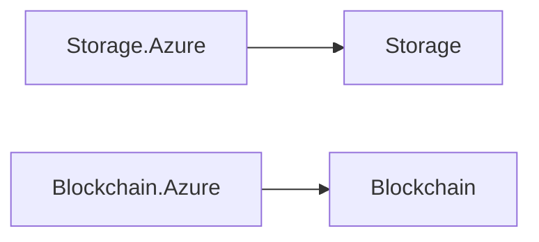

# Storage and ledger

File storage behind one contract, implemented on Azure Blob Storage, and a tamper-evident, append-only ledger implemented on Azure Confidential Ledger.

## How the packages fit

Each arrow points at the package it builds on. Rounded, dashed boxes are Nuv Tools packages from another area.

## Packages

| Package | What it does | Builds on |
| --- | --- | --- |
| [Storage](https://www.nuget.org/packages/NuvTools.Storage) | Core abstractions for file storage operations with support for multiple cloud providers. | — |
| [Storage.Azure](https://www.nuget.org/packages/NuvTools.Storage.Azure) | Azure Blob Storage implementation for NuvTools.Storage. | `Storage` |
| [Blockchain](https://www.nuget.org/packages/NuvTools.Blockchain) | Core abstractions for tamper-evident, append-only blockchain ledger operations with support for multiple cloud providers. | — |
| [Blockchain.Azure](https://www.nuget.org/packages/NuvTools.Blockchain.Azure) | Azure Confidential Ledger implementation of NuvTools.Blockchain, providing tamper-evident ledger storage backed by Azure.Security.ConfidentialLedger and DefaultAzureCredential. | `Blockchain` |

## Guides

- [NuvTools.Storage](storage/README.md) — installation, configuration and examples; source on [GitHub](https://github.com/nuvtools/nuvtools-storage).
- [NuvTools.Blockchain](blockchain/README.md) — installation, configuration and examples; source on [GitHub](https://github.com/nuvtools/nuvtools-blockchain).

Every type and member is in the [API reference](../../api/index.md#area-storage).
