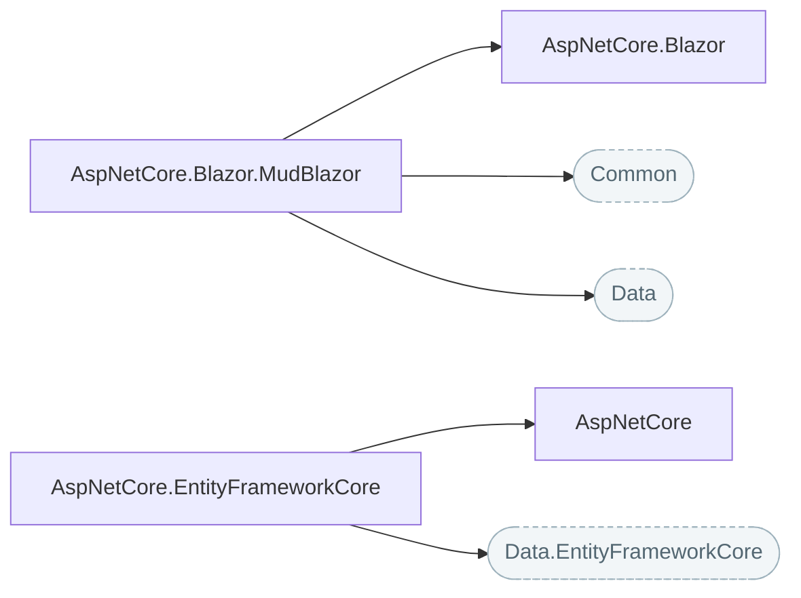

# ASP.NET Core and Blazor

Helpers for ASP.NET Core applications and Blazor clients: CRUD service bases, composite localization, JavaScript interop and MudBlazor components.

## How the packages fit

Each arrow points at the package it builds on. Rounded, dashed boxes are Nuv Tools packages from another area.

## Packages

| Package | What it does | Builds on |
| --- | --- | --- |
| [AspNetCore](https://www.nuget.org/packages/NuvTools.AspNetCore) | ASP.NET Core helpers including composite localization. | — |
| [AspNetCore.Blazor](https://www.nuget.org/packages/NuvTools.AspNetCore.Blazor) | Blazor helpers including JavaScript interop services for clipboard, localStorage, sessionStorage, loading indicator, file download, and exit confirmation, plus a camera capture component. | — |
| [AspNetCore.Blazor.MudBlazor](https://www.nuget.org/packages/NuvTools.AspNetCore.Blazor.MudBlazor) | MudBlazor helpers including converters, validators, and server-paged table base component. | `AspNetCore.Blazor`, `Common`, `Data` |
| [AspNetCore.EntityFrameworkCore](https://www.nuget.org/packages/NuvTools.AspNetCore.EntityFrameworkCore) | Entity Framework Core service base classes with CRUD operations and database migration helpers for ASP.NET Core. | `AspNetCore`, `Data.EntityFrameworkCore` |

## Guides

- [NuvTools.AspNetCore](aspnetcore/README.md) — installation, configuration and examples; source on [GitHub](https://github.com/nuvtools/nuvtools-aspnetcore).

Every type and member is in the [API reference](xref:NuvTools.AspNetCore.Localization).
