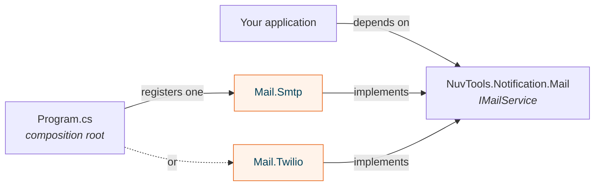

  Open source · MIT
  <h1>Nuv Tools Framework</h1>
  
The .NET libraries behind every Nuv Tools product: data, ASP.NET Core and Blazor, security and identity, notifications, reports, storage and payments. Neutral contracts, one package per provider, ready for .NET 8, 9 and 10.

  

    <a class="nt-btn" href="articles/getting-started.md"><i class="bi bi-rocket-takeoff"></i> Get started</a>
    <a class="nt-btn nt-btn--light" href="api/toc.yml"><i class="bi bi-braces"></i> API reference</a>
    <a class="nt-btn nt-btn--light" href="https://github.com/nuvtools"><i class="bi bi-github"></i> GitHub</a>
  

  <code class="nt-hero__install">dotnet add package NuvTools.Common</code>

  
<strong>40</strong>packages on NuGet

  
<strong>200k+</strong>downloads

  
<strong>8</strong>areas

  
<strong>.NET 10</strong>and 8, 9

## Explore by area

  <a class="nt-card" href="guides/foundation/index.md"><i class="bi bi-bricks"></i><strong>Foundation</strong>Result pattern, common helpers, bilingual resources and Brazilian document validation.</a>
  <a class="nt-card" href="guides/data/index.md"><i class="bi bi-database"></i><strong>Data</strong>Paging and filtering, and an EF Core base for SQL Server and PostgreSQL.</a>
  <a class="nt-card" href="guides/web/index.md"><i class="bi bi-window-stack"></i><strong>ASP.NET Core and Blazor</strong>CRUD services, localization, JavaScript interop and MudBlazor components.</a>
  <a class="nt-card" href="guides/security/index.md"><i class="bi bi-shield-lock"></i><strong>Security and identity</strong>JWT, cryptography, CAPTCHA, ASP.NET Identity, Key Vault signing and ICP-Brasil.</a>
  <a class="nt-card" href="guides/notification/index.md"><i class="bi bi-bell"></i><strong>Notifications</strong>E-mail, messaging and real time on SMTP, Twilio, Service Bus and SignalR.</a>
  <a class="nt-card" href="guides/report/index.md"><i class="bi bi-file-earmark-bar-graph"></i><strong>Reports</strong>PDF, Excel and CSV from your own models, and fixed-length file reading.</a>
  <a class="nt-card" href="guides/storage/index.md"><i class="bi bi-hdd-stack"></i><strong>Storage and ledger</strong>Blob storage and a tamper-evident ledger on Azure.</a>
  <a class="nt-card" href="guides/payment/index.md"><i class="bi bi-credit-card"></i><strong>Payments</strong>Neutral charge and payout contracts with Stripe and Omie clients.</a>

## One contract, many providers

Your application references the contract; the composition root picks the provider. Switching from SMTP to Twilio, or adding a second cloud, never touches the code that sends the e-mail.

Read more in [Architecture](articles/architecture.md), or start with [Getting started](articles/getting-started.md).
